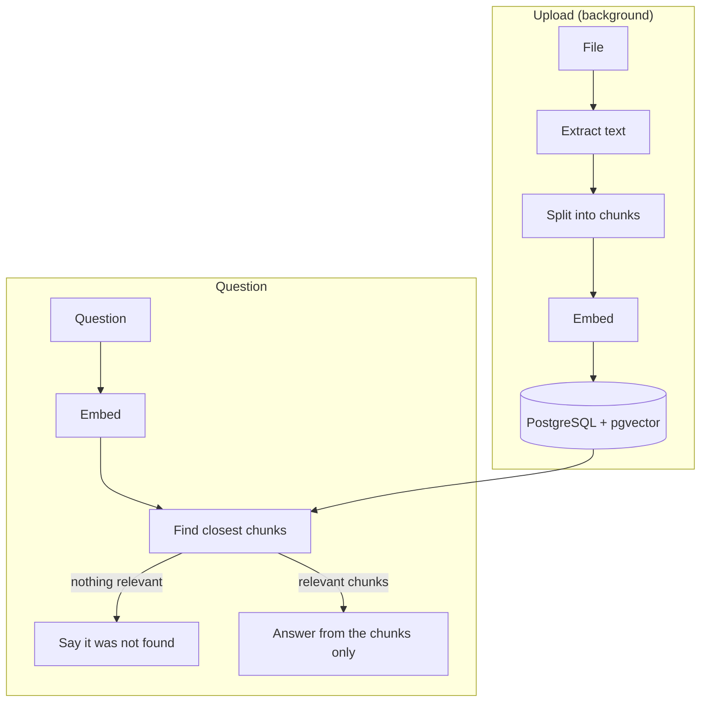

# AskDocs

[](https://github.com/barga-saad/askdocs/actions/workflows/ci.yml)

Upload your documents and ask questions about them. Every answer comes from your files and shows its sources. AskDocs is a retrieval-augmented generation (RAG) application with built-in monitoring.

**Stack:** Java 17, Spring Boot 4, PostgreSQL, pgvector, React 19, TypeScript, Docker, Prometheus, Grafana, GitHub Actions.

## Features

- **Document upload** for PDF, Markdown and text files, processed in the background
- **Vector search** with pgvector and an HNSW index
- **Cited answers** that link back to the source passages
- **Honest answers:** when nothing relevant is found, it says so instead of guessing
- **Runs with no AI setup:** works out of the box, and real models can be switched on with configuration
- **Monitoring** with Prometheus metrics and a ready-made Grafana dashboard

## How it works



## Run it

```bash
docker compose up --build
```

Open <http://localhost:3000> and upload [`samples/employee-handbook.md`](samples/employee-handbook.md). Then ask "How many days of annual leave do employees get?".

| Service | Address |
| --- | --- |
| App | <http://localhost:3000> |
| API documentation | <http://localhost:8080/swagger-ui.html> |

## AI modes

| Mode | Search | Answers | Setup |
| --- | --- | --- | --- |
| Default | Hashing embeddings (keyword matching) | Matching passages | None |
| Full AI | Real embeddings (matches meaning) | Written by a language model | Ollama, or any OpenAI-compatible server |

To use free local models with Ollama:

```bash
AI_CHAT_ENABLED=true AI_EMBEDDING_PROVIDER=openai docker compose --profile ai up --build
docker compose exec ollama ollama pull nomic-embed-text
docker compose exec ollama ollama pull llama3.2
```

Embedding models must produce 768 dimensions. After changing the embedding model, upload your documents again, because vectors from different models cannot be compared.

The default mode uses keywords, so it will not match "holiday" with "annual leave". Real embeddings can.

## Monitoring

```bash
docker compose --profile monitoring up --build
```

Grafana opens at <http://localhost:3001> with an **AskDocs** dashboard showing questions by answer mode, p95 latency, documents ingested, AI fallbacks, 5xx errors and JVM heap. Prometheus is at <http://localhost:9090>.

## Tests

```bash
cd backend && ./mvnw test
cd frontend && npm test
```

Backend integration tests use [Testcontainers](https://testcontainers.com) to start a real PostgreSQL with pgvector, so Docker must be running. AI clients are tested against a local HTTP server, so the real requests are covered.

## CI/CD

Each push runs [`.github/workflows/ci.yml`](.github/workflows/ci.yml):

1. Backend tests with Testcontainers
2. Frontend tests and production build
3. A smoke test that starts the full stack, uploads a file and asks a question
4. On `main`, publishes Docker images to GitHub Container Registry

Dependabot checks dependencies weekly.

## Design decisions

| Decision | Why |
| --- | --- |
| pgvector instead of a separate vector database | One system to run, and documents and vectors stay consistent in one transaction |
| Background ingestion with a bounded queue | Uploads return quickly, and a burst of files cannot exhaust memory |
| AI calls run outside database transactions | A slow model never holds a database connection |
| The model is not called when no source is relevant | Reduces made-up answers and saves model calls |
| Each chunk stores its embedding model | Vectors from different models are never compared |
| The API reports the answer mode | The UI can show whether an answer came from AI or from excerpts |
| Answers are rendered as plain text | Document content cannot inject HTML into the page |

## Limitations

- **No login.** This is a single-user tool, so Docker binds its ports to `127.0.0.1`. Add authentication before exposing it to a network.
- **Scanned PDFs are not supported,** because they contain images rather than text.
- **One backend instance.** Queued uploads are held in memory, and a restart marks unfinished documents as failed.
- Retrieved documents are untrusted text. The prompt tells the model not to follow instructions inside them, which reduces prompt injection but cannot fully prevent it.

## Possible next steps

- Streaming answers as they are generated
- Hybrid search that combines vectors with PostgreSQL full-text search
- Re-ranking of retrieved chunks, and an evaluation set to measure answer quality
- User accounts, with documents separated per user
- A persistent job queue for ingestion

## License

[MIT](LICENSE)
